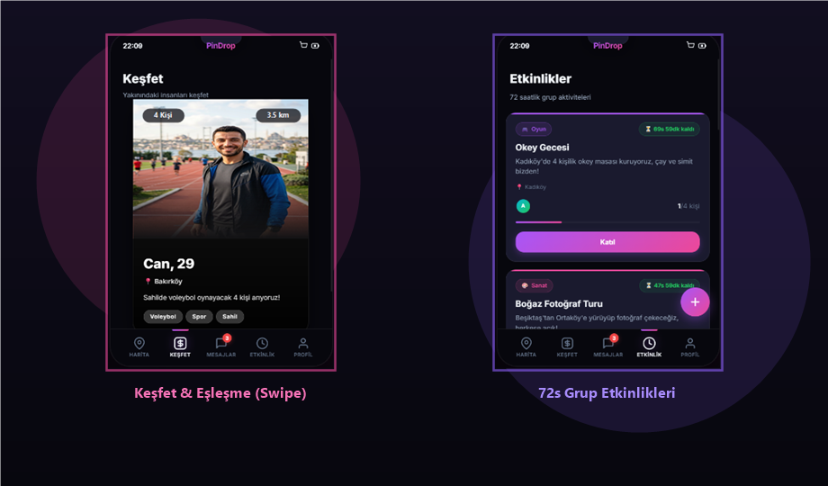
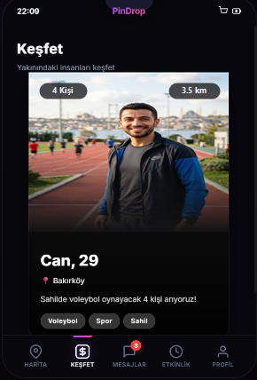
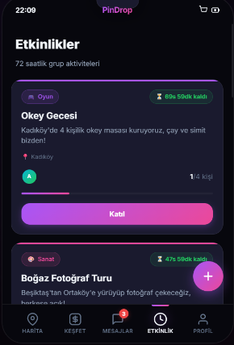

# 🚀 NAPALIM Mobile

<p align="center">
  <b>Şehirdeki spontane buluşmalar, 72 saatlik geri sayımlı etkinlikler ve harita tabanlı sosyal keşif uygulaması.</b>
</p>

<p align="center">
  
  
  
  
  
</p>

<p align="center">
  
</p>

<p align="center">
  
  &nbsp;&nbsp;
  
</p>

---

## ✨ Öne Çıkan Özellikler

### 📍 1. Harita Tabanlı Spontane Keşif
* **Özel Neon Marker'lar:** Şehirdeki popüler mekanlar, kafeler, kutu oyunu kulüpleri ve spor alanları.
* **Pin Ekleme & Upvote:** Haritaya dokunarak ya da *"Buraya Bırak 🎯"* kısayoluyla anında yeni pin bırakma, en yakın ilçe eşleştirme.
* **Yol Tarifi Al (Turn-by-Turn):** Pin kartından tek tıkla **Apple Haritalar 🍏** veya **Google Maps 🌐** üzerinde rota başlatma.

### 💜 2. Keşfet & Eşleşme (Swipe Experience)
* **Akıcı Kart Deneyimi:** Sağa kaydır (Beğen), sola kaydır (Pas), yukarı kaydır (Süper Like).
* **Fotoğrafa Dokunarak Profil İnceleme:** Karta bir kez dokunarak açılan zengin profil sayfası; aşağı kaydırarak geri dönme.
* **Geri Al (Rewind):** Yanlışlıkla sola kaydırılan profili yay animasyonuyla geri getirme.
* **Kader Çarkıfeleği & Buz Kırıcı:** Eşleşme anında otomatik dönen çark ile ilk mesajı kimin atacağının belirlenmesi ve samimi buz kırıcı soruyla sohbete başlama.

### ⏳ 3. 72 Saatlik Süreli Etkinlikler
* **Canlı Geri Sayım:** Süresi dolmadan ekibini toplaman gereken etkinlikler (her saniye canlı akan sayaç, acil durum uyarıları).
* **Kontenjan Takibi & Grup Sohbeti:** Katılımcı avatarları ve grup içi mesajlaşma.
* **Arkadaşını Çağır (Native Paylaşım):** WhatsApp, Instagram veya Telegram üzerinden arkadaşına tek dokunuşla etkinlik daveti gönderme.

### 💬 4. Zengin Canlı Sohbet
* **Çift Mavi Tik (Görüldü):** `sent` (tek gri tik) → `delivered` (çift gri tik) → `read` (çift neon mavi tik).
* **"Yazıyor..." Animasyonu:** Eşleşmelerden gelen yanıtlarda zıplayan 3 noktalı konuşma balonu ve başlıkta canlı bildirim.
* **Üstten Kayan Bildirimler (In-App Toast):** Sohbette değilken gelen mesajlarda üstten kayan interaktif bildirim çubuğu.
* **Mekan Teklifi:** Sohbette ☕ ikonuna basarak anında kahve/mekan daveti kartı gönderme.

### 📳 5. Haptic Feedback (Dokunsal Titreşimler)
* `expo-haptics` ile kart kaydırmalarında, süper like atarken, çark dönerken, pin beğenilerinde ve mesaj gönderirken gerçekçi dokunsal geri bildirimler.

### 👑 6. NAPALIM Premium
* Sınırsız mesafe & yaş filtreleri, gizlenebilir altın taç rozeti, süper like yenilenme sayacı ve geri al ayrıcalıkları.

---

## 🛠️ Teknoloji Yığını (Tech Stack)

| Katman | Teknoloji |
| :--- | :--- |
| **Framework** | [React Native](https://reactnative.dev/) (v0.86) + [Expo](https://expo.dev/) (SDK 57) |
| **Dil** | [TypeScript](https://www.typescriptlang.org/) |
| **Navigasyon** | [React Navigation v7](https://reactnavigation.org/) (Bottom Tabs & Modals) |
| **Harita** | [react-native-maps](https://github.com/react-native-maps/react-native-maps) |
| **Haptic Geri Bildirim** | [expo-haptics](https://docs.expo.dev/versions/latest/sdk/haptics/) |
| **Medya & Fotoğraf** | [expo-image-picker](https://docs.expo.dev/versions/latest/sdk/image-picker/) |
| **İkonlar** | [@expo/vector-icons](https://icons.expo.fyi/) (Ionicons) |

---

## 📁 Proje Dizin Yapısı

```
napalim-mobile/
├── assets/                  # Maskotlar, kullanıcı avatarları ve uygulama ikonları
│   └── screenshots/         # UI vitrin banner'ları ve ekran görüntüleri
├── docs/                    # Mimari belgeler, ajan yönergeleri ve migrasyon planı
│   ├── AGENTS.md
│   └── MIGRATION_PLAN.md
├── src/
│   ├── components/          # Ortak UI bileşenleri (SwipeableBottomSheet, ChatRoomModal, InAppToast vb.)
│   ├── context/             # AppContext (Global State, Auth, Pinler, Sohbetler, İstatistikler)
│   ├── data/                # Mock veriler ve başlangıç profilleri
│   ├── features/
│   │   ├── activities/      # 72 Saatlik Etkinlikler ekranı
│   │   ├── chat/            # Sohbet listesi ekranı
│   │   ├── discover/        # Keşfet (Tinder-style swipe) ekranı
│   │   ├── map/             # Harita ve mekan pinleri ekranı
│   │   └── profile/         # Kullanıcı profili, düzenleme ve Premium mağazası
│   ├── navigation/          # RootNavigator ve Tab Bar
│   ├── services/            # Haptics ve harici servisler
│   ├── theme/               # Neon renk paleti ve stiller
│   └── types/               # TypeScript veri modelleri
├── .env.example             # Çevre değişkenleri şablonu (Gizli anahtarlar korunur)
├── App.tsx                  # Kök bileşen ve sağlayıcılar
├── LICENSE                  # Telif hakları ve lisans sözleşmesi
└── package.json             # Bağımlılıklar ve scriptler
```

---

## 🚀 Başlarken (Kurulum)

### Gereksinimler
* Node.js (v18+)
* npm veya yarn
* Expo Go uygulaması (iOS veya Android cihazınızda)

### Adımlar

1. **Depoyu klonlayın:**
```bash
git clone https://github.com/justalpay/napalim_app_mobile_demo.git
cd napalim_app_mobile_demo
```

2. **Bağımlılıkları yükleyin:**
```bash
npm install
```

3. **Çevre değişkenlerini ayarlayın (Opsiyonel):**
```bash
cp .env.example .env
```
*(Kendi `.env` dosyanızı oluşturup değişkenleri tanımlayın. `.env` dosyası Git tarafından korunur ve asla repoya yüklenmez).*

4. **Uygulamayı başlatın:**
```bash
npx expo start
```
Terminalde çıkan QR kodu telefonunuzdaki **Expo Go** uygulamasıyla tarayarak anında test edebilirsiniz.

---

## 🔒 Güvenlik & API Anahtarı Koruması

Bu proje güvenlik standartlarına uygun şekilde yapılandırılmıştır:
* Tüm `.env`, `.env.*`, `*.pem`, `*.key` ve kimlik dosyaları `.gitignore` tarafından korunmaktadır.
* API anahtarları, AI keyleri ve gizli değişkenler **ASLA** repoya commit edilmez.
* Gerçek değişkenler için `.env.example` dosyasını referans alarak yerel `.env` dosyanızı kullanınız.

---

## 🗺️ Yol Haritası (Roadmap)

- [x] Mobil Frontend UI/UX v1.0 Tamamlandı
- [x] Harita, Pinler ve Yol Tarifi Entegrasyonu
- [x] Zengin Sohbet & Çift Mavi Tik Simülasyonu
- [x] Dokunsal Titreşim (Haptics) & Geri Al (Rewind)
- [ ] **Backend Mimarisinin Kurulumu (Node.js / Express + PostgreSQL)**
- [ ] Canlı WebSocket Mesajlaşma Altyapısı
- [ ] Gerçek OAuth Giriş & Güvenli Kimlik Doğrulama (JWT)
- [ ] PostGIS ile Canlı Konum Sorguları

---

## 📄 Lisans (License)

Bu proje ve beraberindeki tüm fikri mülkiyet hakları **Proprietary (Kapalı Kaynak / Telif Hakları Saklıdır)** olarak lisanslanmıştır.  
**Copyright © 2026 Alpay (NAPALIM). All rights reserved.**

Yazılı izin alınmaksızın kaynak kodlarının, tasarımların, varlıkların veya dokümantasyonun ticari ya da gayriticari olarak kopyalanması, çoğaltılması, dağıtılması veya tersine mühendisliğe tabi tutulması kesinlikle yasaktır. Detaylar için [LICENSE](LICENSE) belgesini inceleyebilirsiniz.
